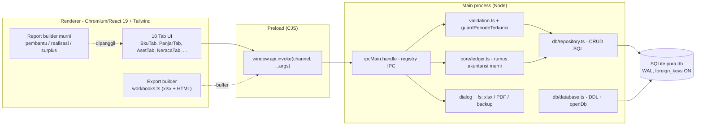
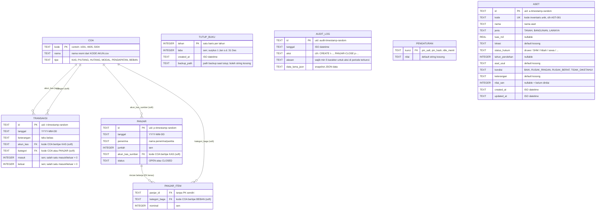
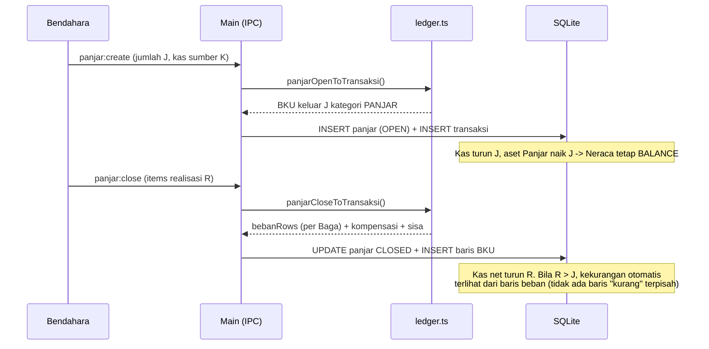

> ⚠️ **Update 2026-10-04 — arah berubah.** Dokumen ini adalah snapshot **v1.2.0 (single-entry)**.
> Pengembangan selanjutnya mengikuti `docs/arah-akuntansi.md`: model `transaksi` digantikan
> `jurnal` + `jurnal_baris` (double-entry), dan PRD tidak lagi dipakai. Gunakan dokumen ini
> hanya untuk memahami kode lama sebelum overhaul.

# ERD & Panduan Sistem — Keuangan Pura Dalem Puri

> Dokumen pembelajaran untuk memahami struktur data dan cara kerja aplikasi.
> Disusun dari pembacaan kode di `src/` (v1.2.0), `PRD.md`, `PROGRESS.md`, dan `KODE AKUN.csv`.
> Terakhir diperiksa: 2026-10-03.

---

## 1. Ringkasan

| Aspek | Keterangan |
|---|---|
| Nama aplikasi | **Keuangan Pura Dalem Puri** (folder repo: `sistem-aset-desa`) |
| Deskripsi | Aplikasi pembukuan keuangan pura, offline-first, desktop |
| Arsitektur | Electron + React + TypeScript + SQLite lokal (tanpa server/cloud) |
| Database | 1 file SQLite (`pura.db`), mode WAL, `foreign_keys = ON` |
| Satuan uang | **Sen** — integer, `1 Rp = 100 sen` (bukan desimal rupiah) |
| Versi | 1.2.0 |

Fungsi utama: input transaksi sekali (**BKU**), lalu otomatis dirangkum menjadi **Buku Pembantu**, **Buku Panjar**, **Realisasi Anggaran**, **Surplus/(Defisit)**, **Neraca** (Aktiva = Pasiva), **Tutup Buku**, dan **Inventaris Aset** terpisah.

---

## 2. Arsitektur Aplikasi



Prinsip arsitektur yang dikunci di kode:

1. **Satu pintu ke DB**: renderer tidak pernah menyentuh SQLite. Semua akses lewat IPC `window.api.invoke` (preload hanya mengekspos `invoke`).
2. **DDL hanya di `src/db/database.ts`**. Tabel dibuat di satu tempat; file lain dilarang menulis DDL.
3. **`src/core/ledger.ts` bebas dependensi** DB/Electron — semua rumus akuntansi (saldo, surplus, neraca, panjar) ada di sini sebagai fungsi murni, sehingga mudah di-test.
4. **`src/core/types.ts` = kontrak data** antara lapisan DB dan fitur. Tipe `Transaksi`, `Panjar`, `PanjarItem`, `TutupBuku`, `AuditLog`, `Aset` didefinisikan di sini.
5. **Builder laporan murni di renderer** (`src/features/reports/*`, `src/features/export/workbooks.ts`); main process hanya menulis file dari buffer (save dialog, `printToPDF`, copy `.db`).

---

## 3. ERD (Entity Relationship Diagram)



### Catatan relasi

- **Hanya satu foreign key keras** di DDL: `panjar_item.panjar_id -> panjar.id`. Relasi lain bersifat **soft** (hanya referensi kode) dan divalidasi di application layer (`isKas()`, `kategoriBolehDipilih()` di `src/db/coa.ts` + `src/main/validation.ts`).
- `transaksi.kategori` boleh berisi kode COA (`PENDAPATAN`, `BEBAN`, `1050`, `2050`, `3000`) **atau** nilai sistem `'PANJAR'` yang bukan akun COA.
- `coa.kode` adalah kunci natural (bukan angka auto-increment). `COA` di-seed ulang otomatis tiap aplikasi dibuka (upsert), jadi perubahan nama di `src/db/coa.ts` ikut memperbaiki DB lama tanpa menghapus transaksi.
- `panjar_item` tidak punya primary key sendiri; satu panjar boleh punya banyak baris baga.

---

## 4. Penjelasan Tabel

### 4.1 `coa` — Chart of Accounts (master akun)

Sumber kebenaran ada di kode: `src/db/coa.ts` (disalin dari `KODE AKUN.csv` dokumen resmi client). Isi 48 akun dikelompokkan:

| Tipe | Jumlah | Fungsi |
|---|---|---|
| `KAS` | 16 | Dompet kas/bank/deposito (kode `1xxx` kecuali 1050) |
| `PIUTANG` | 1 | `1050 PIUTANG LAIN LAIN` — aktiva non-kas |
| `HUTANG` | 1 | `2050 HUTANG LAIN-LAIN` |
| `MODAL` | 3 | `3000 MODAL`, `3001 SALDO KUMULATIF`, `3002 SALDO BERJALAN` |
| `PENDAPATAN` | 12 | Pendapatan `4xxx` (beji, toilet, kios, parkir, punia, dll.) |
| `BEBAN` | 15 | Baga/beban `5xxx` (pamitegep, wewangunan, upakara, dll.) |

<details>
<summary>Daftar lengkap COA (klik untuk buka)</summary>

| Kode | Nama | Tipe |
|---|---|---|
| 1001 | KAS | KAS |
| 1010 | LPD 12.05163/DL/2020 KIOS | KAS |
| 1014 | LPD 12.005150/DL/2020 | KAS |
| 1015 | LPD 12.05165/DL/2020 PARKIR | KAS |
| 1016 | LPD 12.05167/DL/2020 BEJI | KAS |
| 1017 | LPD 12.03905/DL/2018 SHUTLE BUS | KAS |
| 1018 | LPD 12.05164/DL/2020 TOILET | KAS |
| 1019 | LPD BUNGA DEPOSITO 14.15498 | KAS |
| 1020 | LPD BUNGA DEPOSITO 14.15946 | KAS |
| 1021 | LPD BUNGA DEPOSITO 14.16005 | KAS |
| 1028 | KSU USAHA MANDIRI 1519 | KAS |
| 1029 | BANK BPD UBUD 0190202182457 | KAS |
| 1030 | LPD DEPOSITO 15498/SSB/V/2020 | KAS |
| 1031 | LPD DEPOSITO 15946/SSB/LPB/X/2020 | KAS |
| 1032 | LPD DEPOSITO 16005/SSB/LPB/XI/2020 | KAS |
| 1036 | LPD 12.06558 PUNIA PIODALAN | KAS |
| 1050 | PIUTANG LAIN LAIN | PIUTANG |
| 2050 | HUTANG LAIN-LAIN | HUTANG |
| 3000 | MODAL | MODAL |
| 3001 | SALDO KUMULATIF MULAI 10 MARET 2018 | MODAL |
| 3002 | SALDO BERJALAN | MODAL |
| 4001 | PENDAPATAN BEJI | PENDAPATAN |
| 4002 | PENDAPATAN TOILET | PENDAPATAN |
| 4003 | PEDAPATAN KIOS | PENDAPATAN |
| 4004 | PENDAPATAN SHUTLE BUS | PENDAPATAN |
| 4005 | PENDAPATAN PARKIR | PENDAPATAN |
| 4007 | PENDAPATAN KONTRAKAN | PENDAPATAN |
| 4008 | PENDAPATAN PUNIA | PENDAPATAN |
| 4009 | PENDAPATAN BUNGA BANK | PENDAPATAN |
| 4020 | PENDAPATAN LABA PURA | PENDAPATAN |
| 4041 | PENDAPATAN SESARI | PENDAPATAN |
| 4042 | DANA PEMBANGUNAN / SHU DARI LPD | PENDAPATAN |
| 4050 | PENDAPATAN LAIN LAIN | PENDAPATAN |
| 5000 | BIAYA KESEKRETARIATAN | BEBAN |
| 5001 | BAGA KASUKERTAN | BEBAN |
| 5002 | BAGA PAMITEGEP | BEBAN |
| 5003 | BAGA WEWANGUNAN | BEBAN |
| 5004 | BAGA UPAKARA | BEBAN |
| 5005 | BAGA WAHANA | BEBAN |
| 5006 | BAGA HUMAS | BEBAN |
| 5007 | BAGA BOGA | BEBAN |
| 5008 | BAGA WEWALEN/DEKORASI | BEBAN |
| 5009 | BAGA MERERESIK | BEBAN |
| 5010 | BAGA SUAR (TELPON, LISTRIK, PDAM) | BEBAN |
| 5030 | BIAYA PIODALAN | BEBAN |
| 5031 | BIAYA PROYEK | BEBAN |
| 5040 | BIAYA ADMINISTRASI DAN PAJAK BANK | BEBAN |
| 5050 | BIAYA LAIN-LAIN | BEBAN |

</details>

> **Penting**: PRD lama (§2) memakai kode yang berbeda (mis. `1000 Kas Tunai`). Yang berlaku adalah `KODE AKUN.csv` + `src/db/coa.ts`. Tidak ada kode `1000`; kas tunai = `1001`. Jangan pernah mengandalkan rentang kode (`4xxx`/`5xxx`) — selalu pakai kolom `tipe`.
>
> **Akun legacy 3001/3002:** `3001 SALDO KUMULATIF` dan `3002 SALDO BERJALAN`
> tetap ditampilkan di COA, Buku Besar, Neraca, dan laporan lain agar saldo lama
> bisa diperiksa. Keduanya **tidak boleh dipilih untuk posting baru**: helper
> `akunBolehDiposting()` di `src/db/coa.ts` menolaknya, `validasiJurnal()` dan
> `insertJurnal()` menolak sebagai pertahanan terakhir, dan pilihan akun di form
> posting (Jurnal Umum, impor Excel) menyaringnya. `3000 MODAL` tetap boleh
> diposting (mis. setoran modal/saldo awal). Akun nonaktif juga ditolak.

### 4.2 `transaksi` — Buku Kas Umum (inti ledger)

Satu baris = satu mutasi kas/bank. Tidak ada kolom saldo berjalan; **saldo selalu dihitung ulang** dari histori (single source of truth).

- `akun_kas`: dompet yang berubah (harus tipe `KAS`).
- `kategori`: sifat lawan transaksi:
  - `PENDAPATAN` (`4xxx`) / `BEBAN` (`5xxx`) — operasional.
  - `1050` — pemberian pinjaman (`keluar`) / pelunasan diterima (`masuk`).
  - `2050` — terima utang (`masuk`) / bayar utang (`keluar`).
  - `3000` — setoran modal.
  - `PANJAR` — hanya dibuat sistem untuk mutasi panjar (bukan akun COA).
- `masuk`/`keluar` integer sen; **salah satu wajib 0**, total > 0 (divalidasi di `validateTransaksiInput`).
- `3001` dan `3002` tidak boleh diinput user; nilainya turunan (`tutup_buku` + surplus periode).
- Index: `tanggal`, `akun_kas`, `kategori`.

### 4.3 `panjar` + `panjar_item` — Uang muka kerja

- `panjar.jumlah` = uang yang diberikan; `panjar.akun_kas_sumber` = dompet asal.
- Saat **OPEN** (dibuat): otomatis ada baris BKU `keluar` sebesar `jumlah` dengan kategori `PANJAR` (kas turun, aset panjar naik — neraca tetap balance).
- Saat **CLOSE**: `panjar_item` (rincian realisasi per Baga) diubah menjadi baris beban + baris kompensasi `PANJAR` + baris sisa (bila ada), semuanya lewat `panjarCloseToTransaksi()` di `src/core/ledger.ts`.
- `status`: `OPEN` (masih di penerima) atau `CLOSED` (sudah direalisasikan).

### 4.4 `tutup_buku` — Akumulasi laba per tahun

- Satu baris per tahun (`tahun` PK), `laba` = surplus `1 Jan – 31 Des` tahun itu.
- Dipakai menghitung **Saldo Kumulatif (3001)** = total laba tahun-tahun sebelum tahun cut-off.
- `INSERT OR REPLACE`: tahun yang sama bisa ditutup ulang (menimpa).
- `backup_path` menyimpan lokasi backup otomatis saat wizard tutup buku dijalankan.

### 4.5 `audit_log` — Jejak audit kunci longgar

- Terisi saat ada **create/close pada periode yang sudah ditutup** (tanggal ≤ 31 Des tahun tutup terakhir).
- Aksi terkunci boleh tetap dilakukan, tapi **wajib alasan ≥ 5 karakter**; jika tidak, sistem menolak.
- `data_lama_json` menyimpan snapshot data terkait.

### 4.6 `pengaturan` — Key-value konfigurasi lokal

Menyimpan `pin_salt`, `pin_hash` (PIN 6 digit), dan `idle_menit` (auto-lock, 5–120 menit, default 30).

### 4.7 `aset` — Inventaris Aset (non-keuangan)

- **Terisolasi penuh dari ledger/neraca**. Nilai aset (`nilai_sen`) tidak pernah masuk persamaan Aktiva = Pasiva.
- `kode` unik (UNIQUE constraint), mis. `AST-001`.
- `nilai_sen` dan `luas_m2` boleh `NULL` (mis. tanah druwe yang belum dinilai).
- Tidak terpengaruh kunci tutup buku.

---

## 5. Rumus Akuntansi (dari `src/core/ledger.ts`)

### 5.1 Saldo kas
```
Saldo(akun, cutoff) = Σ masuk − Σ keluar   untuk baris akun tersebut pada tanggal ≤ cutoff
```

### 5.2 Surplus / (Defisit)
```
Pendapatan = Σ masuk − Σ keluar  (baris bertipe PENDAPATAN)
Beban      = Σ keluar − Σ masuk  (baris bertipe BEBAN)
Surplus    = Pendapatan − Beban   → negatif ditampilkan "(Rp ...)"
```

### 5.3 Neraca per cut-off
```
AKTIVA = Σ saldo semua KAS + Piutang 1050 + Panjar OPEN
PASIVA = Hutang 2050 + Modal 3000 + Kumulatif 3001 + Berjalan 3002

Kumulatif = Σ laba dari tutup_buku dengan tahun < tahun(cut-off)
Berjalan  = Surplus 1 Jan s.d. cut-off
BALANCE   ⇔ Aktiva − Pasiva = 0
```

`src/features/dashboard/dashboard.ts` menampilkan Saldo Kas Tunai (`1001`), Total LPD (akun bernama mengandung "LPD"), dan badge `BALANCE`/`SELISIH ...` — semuanya membaca `neraca()`, tidak menghitung ulang dengan cara berbeda.

### 5.4 Alur Panjar (invarian kas & neraca)



---

## 6. Modul & Tab Aplikasi

Urutan tab sesuai `src/renderer/App.tsx`:

| Tab | File utama | Isi |
|---|---|---|
| Dashboard | `DashboardTab.tsx` | Kas tunai, total LPD, badge balance, tombol backup/restore/export |
| Buku Kas Umum | `BkuTab.tsx` | Form input, tabel + pagination + filter, chip saldo per kas |
| Inventaris Aset | `AsetTab.tsx` | CRUD aset, filter jenis/pencarian, export xlsx/PDF ber-kop |
| Buku Panjar | `PanjarTab.tsx` | Buat panjar, rincian baga, close + live sisa/kurang |
| Pembantu | `PembantuTab.tsx` | Sub-ledger per kode akun (kas maupun kategori) |
| Realisasi | `RealisasiTab.tsx` | Grouping pendapatan per jenis, pengeluaran per baga, net total |
| Surplus | `SurplusTab.tsx` | Laba-rugi per periode + persentase |
| Neraca | `NeracaTab.tsx` | Aktiva vs Pasiva per cut-off, export xlsx + PDF |
| Tutup Buku | `TutupTab.tsx` | Wizard 3 langkah: auto-backup → preview laba → konfirmasi |
| Pengaturan | `PengaturanTab.tsx` | Ganti PIN, atur idle auto-lock |

Kunci aplikasi (LockScreen) dipaksa sejak pertama kali dibuka: wajib buat PIN 6 digit, sesi selalu terkunci saat app start, auto-lock saat idle.

---

## 7. Daftar IPC Channel (`src/main/index.ts`)

| Channel | Fungsi |
|---|---|
| `coa:list` | Daftar akun COA (satu-satunya channel yang boleh diakses saat terkunci, bersama `lock:*`) |
| `lock:status`, `lock:setup`, `lock:unlock`, `lock:lock`, `lock:change`, `lock:idle-set`, `lock:reset` | Manajemen PIN & sesi |
| `transaksi:list`, `transaksi:create` | BKU (create butuh `alasan` bila periode terkunci) |
| `panjar:list`, `panjar:items`, `panjar:create`, `panjar:close` | Buku Panjar |
| `aset:list`, `aset:create`, `aset:update`, `aset:delete` | Inventaris aset |
| `saldo:list` | Saldo semua kas (opsional cut-off) |
| `neraca:get`, `dashboard:get` | Laporan read-only (validasi format cut-off `YYYY-MM-DD`) |
| `tutup:list`, `tutup:preview`, `tutup:create` | Tutup buku |
| `audit:list` | Riwayat audit |
| `file:save-buffer`, `file:save-pdf` | Simpan xlsx/HTML dan cetak PDF (via hidden window `printToPDF`) |
| `backup:export`, `backup:auto`, `backup:import`, `backup:status` | Backup/restore `.db` |

Semua handler mengembalikan `{ ok: true, data }` atau `{ ok: false, error, perluAlasan? }`.

**Gembok data**: selain channel `lock:*` dan `coa:list`, semua IPC ditolak bila PIN sudah di-setup tetapi sesi belum dibuka — mencegah bypass lewat DevTools.

---

## 8. Lokasi File & Backup

| Hal | Lokasi |
|---|---|
| DB produksi | `<userData>/data/pura.db` — Windows: `%APPDATA%\Keuangan Pura Dalem Puri\data\pura.db`; macOS: `~/Library/Application Support/Keuangan Pura Dalem Puri/data/pura.db` |
| Override dev | Env `PURA_DB` (dibaca dari `.env` hanya saat `!app.isPackaged`) |
| Auto-backup harian | `<userData>/data/backups/auto-YYYY-MM-DD.db`, dibuat via `VACUUM INTO` (aman saat DB terbuka), retensi 7 file terakhir |
| Backup saat tutup buku | `backup:auto` → `<userData>/data/backups/pura-<tahun>.db` |
| Backup manual | Tombol di Dashboard → dialog simpan `pura-backup-YYYY-MM-DD.db` |
| Seed dev | `PURA_SEED_DEV=true` (hanya dev, DB transaksi kosong) → 240 baris dummy deterministik |

---

## 9. Keamanan & Kunci Aplikasi

- PIN **6 digit**, disimpan sebagai `scrypt(pin, salt)` — `N=16384, r=8, p=1`, salt acak 16 byte per database.
- Sesi hanya di memori; **selalu terkunci saat aplikasi dibuka**.
- Salah 5× → blokir 60 detik.
- Auto-lock idle 5–120 menit (default 30), timer reset oleh aktivitas mouse/keyboard/scroll.
- Lupa PIN dapat direset dengan **kode darurat**. Default di kode: `PURI-DARURAT-1945` (`src/main/kunci.ts`) — bisa dioverride via env `PURA_RESET_CODE` saat dev. **Ganti sebelum distribusi ke bendahara.**

---

## 10. Teknologi & Perintah

Dependensi utama: `electron` 44, `react` 19, `typescript` 7, `better-sqlite3` 13 (sinkron), `drizzle-orm` 0.45 (terpasang, tetapi skema aktual memakai SQL manual di `database.ts`), `exceljs`, `tailwindcss` 4, `vitest` 5.

| Perintah | Fungsi |
|---|---|
| `npm run dev` | Jalankan aplikasi Electron (dev) |
| `npm test` | Vitest (per PROGRESS: 61/61 hijau per 2026-09-07) |
| `npm run typecheck` | `tsc --noEmit` |
| `npm run build` | Build produksi electron-vite |
| `npm run dist:win` | Build installer Windows (NSIS + portable) |

Struktur folder penting:

```
src/
  main/        proses utama: IPC, validasi, kunci PIN, dialog file
  preload/     jembatan window.api.invoke
  renderer/    React UI (10 tab + LockScreen)
  core/        types.ts (kontrak), ledger.ts (rumus), pin.ts (aturan PIN)
  db/          database.ts (DDL), coa.ts (seed COA), repository.ts (CRUD), seed-dev.ts
  features/    dashboard, reports (pembantu/realisasi/surplus), export (xlsx/html)
  utils/       format.ts (Rupiah/sen, tanggal, persen)
tests/         12 file test vitest (akurasi, panjar, neraca, aset, backup, kunci, dll.)
data/          DB dev (di-gitignore)
docs/          dokumen ini
```

---

## 11. Urutan Baca yang Disarankan

1. `PRD.md` — kebutuhan bisnis & rumus besar.
2. `PROGRESS.md` — keputusan yang sudah dikunci + status modul.
3. `src/core/types.ts` — kontrak data semua entitas.
4. `src/db/database.ts` — DDL nyata (sumber kebenaran skema).
5. `src/db/coa.ts` — daftar akun resmi + helper tipe.
6. `src/core/ledger.ts` — semua rumus akuntansi (fungsi murni, ada test-nya).
7. `src/db/repository.ts` — query CRUD.
8. `src/main/index.ts` — alur IPC end-to-end.
9. `src/main/validation.ts` — aturan input.
10. `src/features/reports/*` — cara laporan dibangun dari `Transaksi[]`.
11. Tab renderer di `src/renderer/components/*` — UI per modul.

---

## 12. Gotcha — Hal yang Rawan Salah Paham

1. **Satuan sen, bukan rupiah.** Semua kolom nominal (`masuk`, `keluar`, `jumlah`, `nominal`, `laba`, `nilai_sen`) integer sen. Bagi 100 untuk menampilkan; `parseRupiahToSen()` untuk input.
2. **`transaksi.kategori` bukan selalu COA.** Nilai `'PANJAR'` adalah kategori sistem untuk mutasi panjar. Laporan menamainya "Mutasi Panjar" dan mengecualikannya dari Pendapatan/Beban.
3. **Piutang/hutang punya arah terbalik terhadap kas.** Piutang naik saat `keluar` (pinjamkan), hutang bertambah saat `masuk` (terima utang).
4. **3001/3002 tidak diinput.** Kumulatif dihitung dari `tutup_buku`; berjalan dari surplus periode. Semua jalur posting (Jurnal Umum, form terpandu, impor Excel) menolak keduanya lewat `akunBolehDiposting()` + `validasiJurnal()` + `insertJurnal()`. Form BKU lama juga memblokir keduanya, dan seluruh `tipe KAS` tidak boleh jadi kategori. Akun tetap tampil di laporan/saldo lama.
5. **Kunci tutup buku bersifat "longgar".** Data lama masih bisa diedit/hapus, tapi wajib alasan ≥ 5 karakter yang dicatat ke `audit_log` — bukan dilarang total.
6. **Aset ≠ keuangan.** Nilai inventaris aset tidak memengaruhi Neraca sama sekali (ada test isolasi khusus).
7. **COA di-upsert setiap start.** Jika `transaksi` masih kosong, kode COA yang tidak ada di seed dihapus; jika sudah ada transaksi, baris asing dibiarkan agar tidak ada referensi yatim.
8. **FK hanya satu.** Jangan berasumsi `transaksi.akun_kas`/`kategori` dijaga database; validasinya ada di aplikasi.
9. **`drizzle-orm` terpasang tapi belum dipakai** untuk skema/migrasi. Skema aktual = SQL manual `CREATE TABLE IF NOT EXISTS` (tanpa sistem migrasi; perubahan kolom harus hati-hati terhadap DB lama).
10. **Dua PDF path**: `file:save-pdf` merender HTML di hidden window lalu `printToPDF` (bukan lewat dialog print OS).
