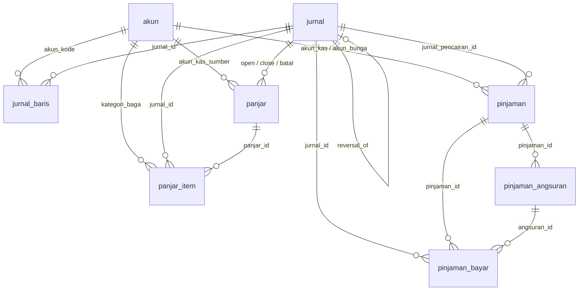

# ERD v2 — Skema Aktif Keuangan Pura Dalem Puri

**Status:** aktif, ditulis 2026-11-02 dari skema `SCHEMA_VERSION = 21`.
**Sumber kebenaran dokumen ini:** DDL di `src/db/database.ts` dan database baru
hasil `openDb(':memory:')` (bukan database produksi/dev).
**Cakupan:** 11 tabel aktif — `akun`, `jurnal`, `jurnal_baris`, `tutup_buku`,
`audit_log`, `pengaturan`, `panjar`, `panjar_item`, `pinjaman`,
`pinjaman_angsuran`, `pinjaman_bayar`.

Dokumen ini adalah kontrak yang diuji otomatis oleh `tests/erd-v2.test.ts`:
setiap heading `### \`nama_tabel\`` dan setiap baris kolom pada tabel Markdown
di bawah harus ada di database baru, dan tidak boleh ada tabel/kolom aktif yang
tidak tercatat. Tabel modul lama yang sudah dihapus tidak didokumentasikan lagi
di sini.

## Prinsip sumber angka

1. **`jurnal` + `jurnal_baris` adalah satu-satunya sumber angka.** Saldo, laba,
   neraca, arus kas, outstanding pinjaman, dan realisasi panjar dihitung ulang
   saat dibaca dari jurnal. Tidak ada tabel saldo/laba tersimpan.
2. **Jurnal tersimpan tidak boleh diedit/dihapus.** Koreksi dilakukan dengan
   jurnal balik (`REVERSAL`, `reversal_of`) + alasan; trigger DB menolak
   UPDATE/DELETE `jurnal` dan `jurnal_baris`.
3. **`tutup_buku` hanya penanda periode + kunci tanggal.** Tabel ini tidak
   menyimpan laba atau jurnal penutup.
4. **`audit_log` append-only.** Waktu peristiwa audit memakai kolom `tanggal`;
   tabel ini sengaja tidak memiliki `created_at`. Trigger menolak UPDATE/DELETE.
5. **`panjar` menyimpan header operasional, bukan angka turunan.** `tanggal`,
   `jumlah`, dan `akun_kas_sumber` adalah cermin jurnal serah; `total_realisasi`,
   `sisa`, dan `kurang` dihitung dari `panjar_item` + jurnal. Status publik
   `DIBATALKAN` diturunkan dari `jurnal_batal_id`, bukan nilai `status` baru.
6. **`pinjaman_angsuran` adalah rencana; jurnal adalah realisasi.**
   `pinjaman_bayar` hanya menautkan `jurnal_id` + `angsuran_id`; nominal
   pokok/bunga/denda dibaca dari baris jurnal. Outstanding =
   `sisa_pokok_awal - SUM(debit 2050 pada jurnal pembayaran tertaut)` dan tidak
   pernah disimpan sebagai saldo berjalan.
7. **`akun.nama` unik tanpa membedakan huruf besar/kecil** lewat unique index
   `ux_akun_nama_nocase` (DB-11). Constraint ini tidak diduplikasi di tempat
   lain; trigger akun hanya memvalidasi bentuk kode/nama/tipe/posisi/aktif.

## Kebijakan tabel baru: `STRICT` + `DEFAULT`

Saat DB-30 diaudit, **11 tabel aktif belum memakai `STRICT`**. Tabel
`pinjaman`, `pinjaman_angsuran`, dan `pinjaman_bayar` dibuat pada v20, sebelum
kebijakan ini, dan sudah mungkin berisi data. Ticket DB-30 **tidak boleh**
merebuild tabel lama/tabel pinjaman tanpa ticket migrasi terpisah dan kenaikan
`SCHEMA_VERSION`; karena itu DDL pinjaman dibiarkan apa adanya.

Kebijakan untuk **tabel baru setelah DB-30**:

- Wajib `CREATE TABLE ... (...) STRICT`.
- Kolom `NOT NULL` wajib punya `DEFAULT` eksplisit bila nilainya boleh diisi
  aplikasi secara wajar.
- `created_at` wajib `TEXT NOT NULL` dengan default waktu eksplisit. SQLite
  hanya menerima konstanta atau `CURRENT_TIMESTAMP`; ekspresi seperti
  `DEFAULT (strftime(...))` ditolak dengan error *default value ... is not
  constant*. Pilihan aman: `DEFAULT CURRENT_TIMESTAMP` (UTC,
  `YYYY-MM-DD HH:MM:SS`) lalu aplikasi menormalisasi/mengisi ISO penuh
  (`YYYY-MM-DDTHH:MM:SS.sssZ`) saat INSERT, atau isi ISO penuh dari aplikasi
  tanpa mengandalkan default DB.
- Jangan menyalin DDL `pinjaman*` yang non-STRICT/tanpa default `created_at`
  untuk tabel baru. Tabel lama hanya boleh direbuild lewat ticket khusus yang
  menaikkan `SCHEMA_VERSION` dan menyediakan migrasi + backup.

Kolom waktu pada skema aktif saat ini:

| Tabel | Kolom waktu | Default DB | Catatan |
|---|---|---|---|
| `jurnal` | `created_at` | tidak ada | diisi ISO oleh repository/posting |
| `tutup_buku` | `created_at` | tidak ada | diisi ISO oleh `tutupBuku` |
| `panjar` | `created_at` | tidak ada | diisi ISO oleh repository panjar |
| `pinjaman` | `created_at` | tidak ada | warisan v20, diisi ISO oleh aplikasi |
| `pinjaman_bayar` | `created_at` | tidak ada | warisan v20, diisi ISO oleh aplikasi |
| `audit_log` | `tanggal` | tidak ada | waktu peristiwa audit, bukan `created_at` |

## Diagram relasi

`tutup_buku`, `audit_log`, dan `pengaturan` tidak memiliki foreign key.

## Tabel aktif

### `akun`

Master COA. `sumber = 'BAWAAN'` untuk akun dari COA statis dan `'TAMBAHAN'`
untuk akun buatan operator. Akun tidak dihapus jika sudah dipakai histori;
akun bawaan boleh dinonaktifkan.

| Kolom | Tipe | Null | Default | Kunci/Constraint |
|---|---|---|---|---|
| `kode` | TEXT | tidak efektif | — | PRIMARY KEY; trigger wajib tepat 4 digit angka |
| `nama` | TEXT | tidak | — | trigger wajib non-kosong; unique NOCASE `ux_akun_nama_nocase` |
| `tipe` | TEXT | tidak | — | trigger: AKTIVA/KEWAJIBAN/EKUITAS/PENDAPATAN/BEBAN |
| `posisi_normal` | TEXT | tidak | — | trigger: cocok dengan `tipe` |
| `aktif` | INTEGER | tidak | `1` | trigger: hanya 0/1 |
| `is_kas` | INTEGER | tidak | `0` | metadata kas/bank (DB-14) |
| `kelompok` | TEXT | tidak | `''` | metadata kelompok laporan |
| `sumber` | TEXT | tidak | `'BAWAAN'` | BAWAAN/TAMBAHAN (divalidasi aplikasi) |

**Index:** `ux_akun_nama_nocase` — UNIQUE pada `nama COLLATE NOCASE`.
**Trigger:** `trg_akun_validasi_insert`, `trg_akun_validasi_update`.
**Relasi:** dirujuk `jurnal_baris.akun_kode`, `panjar.akun_kas_sumber`,
`panjar_item.kategori_baga`, `pinjaman.akun_kas`, `pinjaman.akun_bunga`.

### `jurnal`

Kepala jurnal double-entry. Satu baris = satu bukti/transaksi. `grup_id`
mengelompokkan jurnal asli + reversal. `created_at` adalah waktu pencatatan,
bukan tanggal akuntansi.

| Kolom | Tipe | Null | Default | Kunci/Constraint |
|---|---|---|---|---|
| `id` | TEXT | tidak efektif | — | PRIMARY KEY |
| `tanggal` | TEXT | tidak | — | trigger: `YYYY-MM-DD` |
| `no_bukti` | TEXT | tidak | `''` | unik per tahun (partial index) |
| `keterangan` | TEXT | tidak | — | — |
| `jenis` | TEXT | tidak | `'UMUM'` | trigger: jenis resmi aplikasi |
| `grup_id` | TEXT | tidak | — | index |
| `reversal_of` | TEXT | ya | — | FK `jurnal(id)`; unik bila tidak NULL |
| `created_at` | TEXT | tidak | — | ISO dari aplikasi |

**Index:** `idx_jurnal_tanggal`, `idx_jurnal_grup`, `idx_jurnal_reversal`,
`idx_jurnal_no_bukti_tahun` (UNIQUE partial per tahun + `no_bukti` NOCASE bila
tidak kosong), `ux_jurnal_saldo_awal` (UNIQUE partial, hanya satu
`SALDO_AWAL`), `ux_jurnal_reversal` (UNIQUE partial, satu reversal per jurnal).
**Trigger:** `trg_jurnal_validasi_insert`, `trg_jurnal_immutable_update`,
`trg_jurnal_immutable_delete`.
**Relasi:** induk `jurnal_baris`, `panjar` (open/close/batal), `panjar_item`,
`pinjaman` (pencairan), `pinjaman_bayar`; self-reference `reversal_of`.

### `jurnal_baris`

Baris debit/kredit. Hanya satu sisi yang boleh terisi per baris. Semua angka
laporan berasal dari tabel ini.

| Kolom | Tipe | Null | Default | Kunci/Constraint |
|---|---|---|---|---|
| `id` | INTEGER | tidak efektif | — | PRIMARY KEY AUTOINCREMENT |
| `jurnal_id` | TEXT | tidak | — | FK `jurnal(id)` ON DELETE CASCADE |
| `akun_kode` | TEXT | tidak | — | FK `akun(kode)` |
| `debit` | INTEGER | tidak | `0` | CHECK `debit >= 0`; trigger satu sisi |
| `kredit` | INTEGER | tidak | `0` | CHECK `kredit >= 0`; trigger satu sisi |
| `keterangan` | TEXT | tidak | `''` | — |

**Check:** `(debit >= 0 AND kredit >= 0)` dan `(debit > 0 OR kredit > 0)`.
**Index:** `idx_jurnal_baris_jurnal`, `idx_jurnal_baris_akun`.
**Trigger:** `trg_jurnal_baris_satu_sisi_insert`,
`trg_jurnal_baris_satu_sisi_update`, `trg_jurnal_baris_immutable_update`,
`trg_jurnal_baris_immutable_delete`.
**Relasi:** anak `jurnal` dan `akun`.

### `tutup_buku`

Penanda tahun yang sudah dikunci. Tidak menyimpan laba, saldo, atau jurnal
penutup. `backup_path` adalah kolom legacy yang tidak lagi dipakai UI sejak
DB-28; dipertahankan agar tabel tidak direbuild.

| Kolom | Tipe | Null | Default | Kunci/Constraint |
|---|---|---|---|---|
| `tahun` | INTEGER | tidak efektif | — | PRIMARY KEY |
| `created_at` | TEXT | tidak | — | ISO dari aplikasi |
| `backup_path` | TEXT | tidak | `''` | legacy, tidak dipakai UI |
| `catatan` | TEXT | tidak | `''` | — |

**Trigger:** `trg_tutup_buku_immutable_delete`.
**Relasi:** tidak ada foreign key.

### `audit_log`

Jejak audit append-only. Waktu peristiwa disimpan di `tanggal`; tabel ini tidak
memiliki `created_at`. `data_lama_json`/`data_baru_json` menyimpan kondisi
sebelum/sesudah, sedangkan `ref_type`/`ref_id` menunjuk objek terkait (DB-27).

| Kolom | Tipe | Null | Default | Kunci/Constraint |
|---|---|---|---|---|
| `id` | TEXT | tidak efektif | — | PRIMARY KEY |
| `tanggal` | TEXT | tidak | — | waktu peristiwa audit |
| `aksi` | TEXT | tidak | — | — |
| `alasan` | TEXT | tidak | — | — |
| `data_lama_json` | TEXT | tidak | `''` | JSON kondisi lama |
| `data_baru_json` | TEXT | tidak | `''` | JSON kondisi baru |
| `ref_type` | TEXT | tidak | `''` | tipe objek referensi |
| `ref_id` | TEXT | tidak | `''` | id objek referensi |

**Index:** `idx_audit_tanggal`, `idx_audit_aksi`, `idx_audit_ref(ref_type, ref_id)`.
**Trigger:** `trg_audit_log_immutable_update`, `trg_audit_log_immutable_delete`.
**Relasi:** tidak ada foreign key (referensi terstruktur bersifat logis).

### `pengaturan`

Key-value pengaturan aplikasi (PIN, nama entitas, tanggal mulai pembukuan,
preferensi UI).

| Kolom | Tipe | Null | Default | Kunci/Constraint |
|---|---|---|---|---|
| `kunci` | TEXT | tidak efektif | — | PRIMARY KEY |
| `nilai` | TEXT | tidak | `''` | — |

**Index:** hanya autoindex PRIMARY KEY.
**Relasi:** tidak ada foreign key.

### `panjar`

Header dokumen panjar. `jumlah` dan `tanggal` adalah cermin jurnal serah dan
wajib cocok; nilai turunan tidak disimpan. `status` tersimpan hanya
`OPEN`/`CLOSED`; pembatalan ditandai `jurnal_batal_id` dan status publik
`DIBATALKAN` diturunkan saat membaca.

| Kolom | Tipe | Null | Default | Kunci/Constraint |
|---|---|---|---|---|
| `id` | TEXT | tidak efektif | — | PRIMARY KEY |
| `tanggal` | TEXT | tidak | — | cermin tanggal jurnal serah |
| `penerima` | TEXT | tidak | — | — |
| `jumlah` | INTEGER | tidak | — | CHECK `jumlah > 0`; cermin nominal jurnal serah |
| `akun_kas_sumber` | TEXT | tidak | — | FK `akun(kode)` |
| `status` | TEXT | tidak | `'OPEN'` | CHECK `status IN ('OPEN','CLOSED')` |
| `tanggal_close` | TEXT | ya | — | diisi saat close |
| `jurnal_open_id` | TEXT | tidak | — | FK `jurnal(id)`; UNIQUE |
| `jurnal_close_id` | TEXT | ya | — | FK `jurnal(id)`; UNIQUE bila tidak NULL |
| `created_at` | TEXT | tidak | — | ISO dari aplikasi |
| `jurnal_batal_id` | TEXT | ya | — | FK `jurnal(id)`; UNIQUE bila tidak NULL |
| `tanggal_batal` | TEXT | ya | — | diisi saat batal |
| `alasan_batal` | TEXT | tidak | `''` | alasan pembatalan |

**Index:** `idx_panjar_status`, `idx_panjar_tanggal`, `ux_panjar_jurnal_open`
(UNIQUE), `ux_panjar_jurnal_close` (UNIQUE partial), `ux_panjar_jurnal_batal`
(UNIQUE partial).
**Relasi:** anak `akun` + `jurnal`; induk `panjar_item`.

### `panjar_item`

Rincian nota per baris untuk dokumen panjar. Nominal item adalah detail
realisasi; jurnal close tetap agregat per akun.

| Kolom | Tipe | Null | Default | Kunci/Constraint |
|---|---|---|---|---|
| `id` | INTEGER | tidak efektif | — | PRIMARY KEY AUTOINCREMENT |
| `panjar_id` | TEXT | tidak | — | FK `panjar(id)` ON DELETE CASCADE |
| `kategori_baga` | TEXT | tidak | — | FK `akun(kode)` (akun beban) |
| `nominal` | INTEGER | tidak | — | CHECK `nominal > 0` |
| `jurnal_id` | TEXT | tidak | — | FK `jurnal(id)` |
| `nota_nomor` | TEXT | tidak | `''` | nomor nota (DB-18) |
| `nota_tanggal` | TEXT | tidak | `''` | tanggal nota |
| `toko` | TEXT | tidak | `''` | toko/penerima nota |
| `keterangan` | TEXT | tidak | `''` | keterangan baris |

**Index:** `idx_panjar_item_panjar`.
**Relasi:** anak `panjar`, `akun`, dan `jurnal`.

### `pinjaman`

Header perjanjian pinjaman LPD. `sisa_pokok_awal` adalah saldo awal yang sudah
ada di Saldo Awal 2050 (bukan saldo berjalan). `jurnal_pencairan_id = NULL`
berarti pinjaman sudah berjalan dan modul tidak membuat jurnal pencairan baru.
Tabel ini berasal dari v20 dan belum `STRICT` (lihat kebijakan tabel baru).

| Kolom | Tipe | Null | Default | Kunci/Constraint |
|---|---|---|---|---|
| `id` | TEXT | tidak efektif | — | PRIMARY KEY |
| `kreditur` | TEXT | tidak | — | — |
| `akun_kas` | TEXT | tidak | — | FK `akun(kode)` |
| `akun_bunga` | TEXT | tidak | — | FK `akun(kode)` |
| `pokok_awal` | INTEGER | tidak | — | CHECK `pokok_awal > 0` |
| `sisa_pokok_awal` | INTEGER | tidak | — | CHECK `sisa_pokok_awal >= 0` |
| `tanggal_mulai` | TEXT | tidak | — | `YYYY-MM-DD` divalidasi aplikasi |
| `tenor_bulan` | INTEGER | ya | — | CHECK `tenor_bulan > 0` bila diisi |
| `jurnal_pencairan_id` | TEXT | ya | — | UNIQUE; FK `jurnal(id)` |
| `catatan` | TEXT | tidak | `''` | — |
| `created_at` | TEXT | tidak | — | ISO dari aplikasi; warisan v20 tanpa default DB |

**Index:** `idx_pinjaman_tanggal`, `idx_pinjaman_kreditur`; autoindex UNIQUE
untuk `jurnal_pencairan_id`.
**Relasi:** anak `akun` + `jurnal`; induk `pinjaman_angsuran` dan
`pinjaman_bayar`.

### `pinjaman_angsuran`

Rencana jadwal angsuran. Bukan realisasi; status lunas diturunkan dari
`pinjaman_bayar.angsuran_id`. Tabel ini berasal dari v20 dan belum `STRICT`.

| Kolom | Tipe | Null | Default | Kunci/Constraint |
|---|---|---|---|---|
| `id` | INTEGER | tidak efektif | — | PRIMARY KEY AUTOINCREMENT |
| `pinjaman_id` | TEXT | tidak | — | FK `pinjaman(id)` ON DELETE CASCADE |
| `ke` | INTEGER | tidak | — | CHECK `ke > 0`; UNIQUE `(pinjaman_id, ke)` |
| `jatuh_tempo` | TEXT | tidak | — | `YYYY-MM-DD` divalidasi aplikasi |
| `pokok` | INTEGER | tidak | — | CHECK `pokok >= 0` (rencana) |
| `bunga` | INTEGER | tidak | — | CHECK `bunga >= 0` (rencana) |
| `catatan` | TEXT | tidak | `''` | — |

**Index:** `idx_pinjaman_angsuran_pinjaman`, `idx_pinjaman_angsuran_jatuh_tempo`;
autoindex UNIQUE `(pinjaman_id, ke)`.
**Relasi:** anak `pinjaman`; dirujuk `pinjaman_bayar.angsuran_id`.
**Tidak ada:** `created_at`, nominal realisasi, status lunas tersimpan, saldo.

### `pinjaman_bayar`

Link pembayaran ke jurnal + angsuran. Tidak menyimpan nominal pokok/bunga/denda
maupun saldo berjalan. Tabel ini berasal dari v20 dan belum `STRICT`.

| Kolom | Tipe | Null | Default | Kunci/Constraint |
|---|---|---|---|---|
| `id` | TEXT | tidak efektif | — | PRIMARY KEY |
| `pinjaman_id` | TEXT | tidak | — | FK `pinjaman(id)` |
| `angsuran_id` | INTEGER | ya | — | FK `pinjaman_angsuran(id)`; UNIQUE bila tidak NULL |
| `jurnal_id` | TEXT | tidak | — | UNIQUE; FK `jurnal(id)` |
| `tanggal` | TEXT | tidak | — | tanggal pembayaran |
| `catatan` | TEXT | tidak | `''` | — |
| `created_at` | TEXT | tidak | — | ISO dari aplikasi; warisan v20 tanpa default DB |

**Index:** `idx_pinjaman_bayar_pinjaman`, `idx_pinjaman_bayar_tanggal`,
`ux_pinjaman_bayar_angsuran` (UNIQUE partial); autoindex UNIQUE `jurnal_id`.
**Relasi:** anak `pinjaman`, `pinjaman_angsuran`, dan `jurnal`.
**Tidak ada:** kolom `pokok`, `bunga`, `denda`, `nominal`, `sisa_pokok`, atau
`running_balance`; semua nominal dibaca dari `jurnal_baris`.

## Temuan audit DB-30

- Set tabel aktif tepat **11**; tidak ada tabel modul lama yang kembali dibuat
  atau didokumentasikan sebagai tabel aktif.
- Unique index yang diharapkan ada dan unik: `ux_jurnal_saldo_awal`,
  `ux_jurnal_reversal`, `ux_akun_nama_nocase`, `ux_panjar_jurnal_open`,
  `ux_panjar_jurnal_close`, `ux_panjar_jurnal_batal`, dan
  `ux_pinjaman_bayar_angsuran`; unique inline `pinjaman.jurnal_pencairan_id`,
  `pinjaman_bayar.jurnal_id`, serta `(pinjaman_id, ke)` pada
  `pinjaman_angsuran`.
- `created_at` ada di `jurnal`, `tutup_buku`, `panjar`, `pinjaman`, dan
  `pinjaman_bayar`. `audit_log` memakai `tanggal` (waktu peristiwa), dan
  `pinjaman_angsuran` tidak memiliki timestamp sendiri.
- Tidak ada kolom `sisa_pokok`, `running_balance`, `saldo_berjalan`, atau
  `saldo_pokok` di `pinjaman`, `pinjaman_bayar`, maupun `pinjaman_angsuran`.
  `pinjaman_bayar` juga tidak punya kolom nominal `pokok`/`bunga`/`denda`.
- Semua tabel aktif saat ini **non-STRICT**; tiga tabel `pinjaman*` adalah
  warisan v20 yang sengaja tidak direbuild. Kebijakan `STRICT` hanya berlaku
  untuk tabel baru setelah DB-30.

## Catatan migrasi

- Skema aktif tetap **v21**; DB-30 tidak menaikkan `SCHEMA_VERSION` dan tidak
  melakukan DDL/rebuild apa pun.
- DB lama dibuka lewat migrasi idempoten v2–v21. Tabel modul yang sudah dihapus
  dibuang hanya oleh migrasi v12 yang eksplisit; tabel akuntansi inti dan
  panjar tidak pernah dibuang berdasarkan bentuk kolom.
- `akun.nama` unik NOCASE dipasang oleh migrasi v15 (DB-11), bukan diduplikasi
  di DDL atau trigger.
