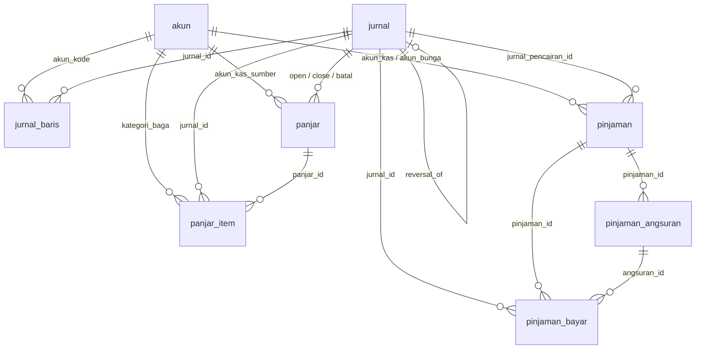

# Skema Baseline v2

**Status dokumen:** Skema baseline v2 (T-A00).
**Skema aktif:** baseline v2 — satu-satunya skema yang didukung aplikasi.
**Sumber kebenaran:** DDL di `src/db/database.ts` (`SCHEMA_VERSION = 2`) dan daftar akun di `src/db/coa.ts`.
**Cakupan:** 12 tabel aktif — `akun`, `jurnal`, `jurnal_baris`, `tutup_buku`, `tutup_buku_snapshot`, `audit_log`, `pengaturan`, `panjar`, `panjar_item`, `pinjaman`, `pinjaman_angsuran`, `pinjaman_bayar`.

Dokumen ini adalah satu-satunya kontrak skema baseline v2. Setiap heading
`### \`nama_tabel\`` diikuti tabel Markdown yang barisnya diawali
`| \`nama_kolom\` |` harus cocok dengan database baru hasil `openDb(':memory:')`:
tidak boleh ada tabel/kolom aktif yang lupa dicatat, dan tidak boleh ada
tabel/kolom hantu di dokumen.

**Kebijakan database:** aplikasi hanya mendukung skema v2
(`SCHEMA_VERSION = 2` di `src/db/database.ts`). File database dengan
`user_version` lain atau tabel asing ditolak sebelum file diubah; tidak ada
konversi otomatis. Database v2 yang **tidak lengkap** — tabel wajib hilang atau
kolom wajib hilang — juga ditolak sebelum `journal_mode = WAL` dan sebelum DDL.
Aplikasi **tidak** membuat ulang tabel/kolom yang hilang dan **tidak**
memigrasikan file: langkah yang benar adalah **memulihkan dari backup sehat**
(Restore Lengkap atau Restore Import `.db`).

**DB v1 kedaluwarsa.** Database dengan `user_version = 1` (11 tabel) ditolak
dengan pesan `PESAN_DB_V1_KEDALUWARSA`. Backup dulu file DB beserta `-wal`/
`-shm`, lalu buat database baru v2 — mis. `npm run db:reset-dev` untuk DB dev
yang memindahkan file lama ke `data/backups/pre-reset-<timestamp>.db`. Aplikasi
tidak mengubah atau memigrasikan file v1 secara otomatis.

**Pemulihan DB tidak lengkap.** Pesan penolakan menyebut nama tabel/kolom
yang hilang. Jangan membuka file itu berulang kali, membuat database baru, atau
menambal dengan `ALTER TABLE`/alat SQLite. Salin file ke tempat aman, lalu
pulihkan dari backup yang lolos validasi. Database v2 yang lengkap tetap dibuka
normal. Membuat database baru hanya untuk file skema lain/asing yang tidak
didukung, dan hanya setelah file lama dipindahkan (bukan ditimpa) serta
dipastikan tidak ada data yang perlu diselamatkan.

## Prinsip sumber angka

1. **`jurnal` + `jurnal_baris` adalah satu-satunya sumber angka.** Saldo, laba,
   neraca, arus kas, outstanding pinjaman, dan realisasi panjar dihitung ulang
   saat dibaca dari jurnal. Tidak ada tabel saldo/laba tersimpan.
2. **Jurnal tersimpan tidak boleh diedit/dihapus.** Koreksi dilakukan dengan
   jurnal balik (`REVERSAL`, `reversal_of`) + alasan; trigger DB menolak
   UPDATE/DELETE `jurnal` dan `jurnal_baris`.
3. **`tutup_buku` hanya penanda periode + kunci tanggal.** Tabel ini tidak
   menyimpan laba atau jurnal penutup.
4. **`audit_log` append-only.** Waktu peristiwa audit memakai kolom `tanggal`;
   tabel ini sengaja tidak memiliki `created_at`. Trigger menolak UPDATE/DELETE.
5. **`panjar` menyimpan header operasional, bukan angka turunan.** `tanggal`,
   `jumlah`, dan `akun_kas_sumber` adalah cermin jurnal serah; `total_realisasi`,
   `sisa`, dan `kurang` dihitung dari `panjar_item` + jurnal. Status resmi:
   `OPEN`, `CLOSED`, atau `DIBATALKAN`. `panjar.sumber` membedakan dokumen
   `NORMAL` dari representasi `SALDO_AWAL` yang menunjuk jurnal pembukaan aktif
   (tanpa jurnal serah kedua).
6. **`pinjaman_angsuran` adalah rencana; jurnal adalah realisasi.**
   `pinjaman_bayar` hanya menautkan `jurnal_id` + `angsuran_id`; nominal
   pokok/bunga/denda dibaca dari baris jurnal. Outstanding =
   `sisa_pokok_awal - pokok pembayaran aktif` (pencairan yang dibatalkan
   bersaldo pembukaan 0) dan tidak pernah disimpan sebagai saldo berjalan.
7. **`akun.nama` unik tanpa membedakan huruf besar/kecil** lewat unique index
   `ux_akun_nama_nocase`. Constraint ini tidak diduplikasi di tempat lain;
   trigger akun hanya memvalidasi bentuk kode/nama/tipe/posisi/aktif.
8. **`jurnal.peran` dan `jurnal.replaces_id` adalah model domain eksplisit.**
   `peran` (`NORMAL`/`OPENING`/`OPENING_REPLACEMENT`/`ADJUSTMENT`) menjawab
   siklus hidup jurnal, sedangkan `jenis` tetap jenis dokumen. `replaces_id`
   menunjuk jurnal yang digantikan dan unik (`ux_jurnal_replaces`). Jurnal
   `OPENING` wajib `SALDO_AWAL` tanpa `reversal_of`; pengganti saldo awal wajib
   `UMUM` + `OPENING_REPLACEMENT`.
9. **Pembukaan/cut-over resmi dibaca dari `pengaturan`, bukan ditebak.**
   `saldo_awal_aktif_id` menunjuk jurnal `OPENING`/`OPENING_REPLACEMENT` aktif,
   dan `cutover_tanggal` adalah tanggal cut-over resmi laporan.
   `akuntansi_tanggal_mulai` dipertahankan sebagai fallback data lama. Laporan
   tidak memakai `MIN(tanggal)` jurnal `SALDO_AWAL`.
10. **`tutup_buku_snapshot` append-only.** Snapshot menyimpan angka hasil
    pembacaan saat tutup buku beserta versi; **bukan sumber angka laporan**.
    Layar laporan dan pratinjau tutup buku tetap menghitung ulang dari jurnal,
    lalu membandingkan hasil live dengan snapshot untuk audit. Snapshot tidak
    boleh diubah/dihapus; `TUTUP-ULANG` menulis versi baru.

## Kebijakan `STRICT`

Seluruh 12 tabel aktif wajib memakai `STRICT` dan diverifikasi lewat
`pragma table_list` setiap database dibuka. Tabel aktif yang tidak `STRICT`
membuat aplikasi menolak skema tersebut.

Kebijakan untuk tabel aktif:

- Wajib `CREATE TABLE ... (...) STRICT`.
- Kolom `NOT NULL` wajib punya `DEFAULT` eksplisit bila nilainya boleh diisi
  aplikasi secara wajar.
- `created_at` wajib `TEXT NOT NULL` dengan default waktu eksplisit. SQLite
  hanya menerima konstanta atau `CURRENT_TIMESTAMP`; ekspresi seperti
  `DEFAULT (strftime(...))` ditolak dengan error *default value ... is not
  constant*. Pilihan aman: `DEFAULT CURRENT_TIMESTAMP` (UTC,
  `YYYY-MM-DD HH:MM:SS`) lalu aplikasi menormalisasi/mengisi ISO penuh
  (`YYYY-MM-DDTHH:MM:SS.sssZ`) saat INSERT, atau isi ISO penuh dari aplikasi
  tanpa mengandalkan default DB.
- Jangan membuat tabel aktif tanpa `STRICT`.

Kolom waktu pada skema baseline v2:

| Tabel | Kolom waktu | Default DB | Catatan |
|---|---|---|---|
| `jurnal` | `created_at` | tidak ada | diisi ISO oleh repository/posting |
| `tutup_buku` | `created_at` | tidak ada | diisi ISO oleh `tutupBuku` |
| `panjar` | `created_at` | tidak ada | diisi ISO oleh repository panjar |
| `pinjaman` | `created_at` | tidak ada | diisi ISO oleh aplikasi |
| `pinjaman_bayar` | `created_at` | tidak ada | diisi ISO oleh aplikasi |
| `audit_log` | `tanggal` | tidak ada | waktu peristiwa audit, bukan `created_at` |

## Diagram relasi



`tutup_buku`, `audit_log`, dan `pengaturan` tidak memiliki foreign key.

## Tabel aktif

### `akun`

Master COA. `sumber = 'BAWAAN'` untuk akun dari COA statis dan `'TAMBAHAN'`
untuk akun buatan operator. Akun tidak dihapus jika sudah dipakai histori;
akun bawaan boleh dinonaktifkan, kecuali empat akun sistem.

| Kolom | Tipe | Null | Default | Kunci/Constraint |
|---|---|---|---|---|
| `kode` | TEXT | tidak | — | PRIMARY KEY; trigger wajib tepat 4 digit angka |
| `nama` | TEXT | tidak | — | trigger wajib non-kosong; unique NOCASE `ux_akun_nama_nocase` |
| `tipe` | TEXT | tidak | — | trigger: AKTIVA/KEWAJIBAN/EKUITAS/PENDAPATAN/BEBAN |
| `posisi_normal` | TEXT | tidak | — | trigger: cocok dengan `tipe` |
| `aktif` | INTEGER | tidak | `1` | trigger: hanya 0/1 |
| `is_kas` | INTEGER | tidak | `0` | metadata kas/bank |
| `kelompok` | TEXT | tidak | `''` | CHECK: kosong atau salah satu kelompok resmi |
| `sumber` | TEXT | tidak | `'BAWAAN'` | CHECK: `BAWAAN`/`TAMBAHAN` |

**Index:** `ux_akun_nama_nocase` — UNIQUE pada `nama COLLATE NOCASE`.
**Trigger:** `trg_akun_validasi_insert`, `trg_akun_validasi_update`.
**Relasi:** dirujuk `jurnal_baris.akun_kode`, `panjar.akun_kas_sumber`,
`panjar_item.kategori_baga`, `pinjaman.akun_kas`, `pinjaman.akun_bunga`.

### `jurnal`

Kepala jurnal double-entry. Satu baris = satu bukti/transaksi. `grup_id`
mengelompokkan jurnal asli + reversal. `created_at` adalah waktu pencatatan,
bukan tanggal akuntansi.

| Kolom | Tipe | Null | Default | Kunci/Constraint |
|---|---|---|---|---|
| `id` | TEXT | tidak | — | PRIMARY KEY |
| `tanggal` | TEXT | tidak | — | trigger: `YYYY-MM-DD` dan tanggal kalender nyata |
| `no_bukti` | TEXT | tidak | `''` | unik per tahun (partial index) |
| `keterangan` | TEXT | tidak | — | — |
| `jenis` | TEXT | tidak | `'UMUM'` | trigger: jenis resmi aplikasi |
| `peran` | TEXT | tidak | `'NORMAL'` | CHECK: `NORMAL`/`OPENING`/`OPENING_REPLACEMENT`/`ADJUSTMENT`; trigger backstop peran |
| `grup_id` | TEXT | tidak | — | index |
| `reversal_of` | TEXT | ya | — | FK `jurnal(id)`; unik bila tidak NULL |
| `replaces_id` | TEXT | ya | — | FK `jurnal(id)`; UNIQUE partial `ux_jurnal_replaces`; hanya untuk peran pengganti |
| `created_at` | TEXT | tidak | — | ISO dari aplikasi |

Jenis jurnal resmi: `UMUM`, `TERIMA`, `BAYAR`, `TRANSFER`, `PANJAR`, `PIUTANG`,
`HUTANG`, `SALDO_AWAL`, `REVERSAL`.

Peran jurnal resmi:

- `NORMAL` — jurnal harian dan reversal;
- `OPENING` — jurnal saldo awal resmi (`jenis = 'SALDO_AWAL'`, `reversal_of`
  null), ditunjuk `pengaturan.saldo_awal_aktif_id`;
- `OPENING_REPLACEMENT` — jurnal `UMUM` pengganti saldo awal, wajib mengisi
  `replaces_id`;
- `ADJUSTMENT` — penyesuaian eksplisit yang menggantikan jurnal lain.

**Index:** `idx_jurnal_tanggal`, `idx_jurnal_grup`, `idx_jurnal_reversal`,
`idx_jurnal_no_bukti_tahun` (UNIQUE partial per tahun + `no_bukti` NOCASE bila
tidak kosong), `ux_jurnal_saldo_awal` (UNIQUE partial, hanya satu
`SALDO_AWAL`), `ux_jurnal_reversal` (UNIQUE partial, satu reversal per jurnal),
`ux_jurnal_replaces` (UNIQUE partial, satu jurnal hanya digantikan sekali).
**Trigger:** `trg_jurnal_validasi_insert` (jenis/tanggal/reversal + backstop
peran/`replaces_id`), `trg_jurnal_immutable_update`,
`trg_jurnal_immutable_delete`.
**Relasi:** induk `jurnal_baris`, `panjar` (open/close/batal), `panjar_item`,
`pinjaman` (pencairan), `pinjaman_bayar`; self-reference `reversal_of` dan
`replaces_id`.

### `jurnal_baris`

Baris debit/kredit. Hanya satu sisi yang boleh terisi per baris. Semua angka
laporan berasal dari tabel ini.

| Kolom | Tipe | Null | Default | Kunci/Constraint |
|---|---|---|---|---|
| `id` | INTEGER | tidak | — | PRIMARY KEY AUTOINCREMENT |
| `jurnal_id` | TEXT | tidak | — | FK `jurnal(id)` ON DELETE CASCADE |
| `akun_kode` | TEXT | tidak | — | FK `akun(kode)` |
| `debit` | INTEGER | tidak | `0` | CHECK `debit >= 0`; trigger satu sisi |
| `kredit` | INTEGER | tidak | `0` | CHECK `kredit >= 0`; trigger satu sisi |
| `keterangan` | TEXT | tidak | `''` | — |

**Check:** `(debit >= 0 AND kredit >= 0)` dan `(debit > 0 OR kredit > 0)`.
**Index:** `idx_jurnal_baris_jurnal`, `idx_jurnal_baris_akun`.
**Trigger:** `trg_jurnal_baris_satu_sisi_insert`,
`trg_jurnal_baris_satu_sisi_update`, `trg_jurnal_baris_immutable_update`,
`trg_jurnal_baris_immutable_delete`.
**Relasi:** anak `jurnal` dan `akun`.

### `tutup_buku`

Penanda tahun yang sudah dikunci. Tidak menyimpan laba, saldo, atau jurnal
penutup.

| Kolom | Tipe | Null | Default | Kunci/Constraint |
|---|---|---|---|---|
| `tahun` | INTEGER | tidak | — | PRIMARY KEY; CHECK `tahun BETWEEN 1900 AND 9999` |
| `created_at` | TEXT | tidak | — | ISO dari aplikasi |
| `catatan` | TEXT | tidak | `''` | — |

**Trigger:** `trg_tutup_buku_immutable_delete`.
**Relasi:** tidak ada foreign key.

### `tutup_buku_snapshot`

Snapshot append-only hasil pembacaan angka saat tutup buku (T-A00). Snapshot
bukan sumber angka laporan; laba/saldo tetap dihitung ulang dari jurnal.
`versi` naik pada `TUTUP-ULANG`, dan `UNIQUE(tahun, versi)` mencegah versi yang
sama tertimpa. `hash_jurnal` menyimpan sidik jari jurnal saat snapshot dibuat
sebagai bahan audit T-A06.

| Kolom | Tipe | Null | Default | Kunci/Constraint |
|---|---|---|---|---|
| `id` | INTEGER | tidak | — | PRIMARY KEY AUTOINCREMENT |
| `tahun` | INTEGER | tidak | — | UNIQUE `(tahun, versi)` |
| `versi` | INTEGER | tidak | — | UNIQUE `(tahun, versi)` |
| `laba` | INTEGER | tidak | — | sen |
| `total_aset` | INTEGER | tidak | — | sen |
| `total_kewajiban` | INTEGER | tidak | — | sen |
| `total_ekuitas` | INTEGER | tidak | — | sen |
| `total_pasiva` | INTEGER | tidak | — | sen |
| `selisih` | INTEGER | tidak | — | sen |
| `hash_jurnal` | TEXT | tidak | — | sidik jari jurnal |
| `created_at` | TEXT | tidak | — | ISO dari aplikasi |

**Index:** autoindex UNIQUE `(tahun, versi)`.
**Trigger:** `trg_tutup_buku_snapshot_immutable_update`,
`trg_tutup_buku_snapshot_immutable_delete`.
**Relasi:** tidak ada foreign key.

### `audit_log`

Jejak audit append-only. Waktu peristiwa disimpan di `tanggal`; tabel ini tidak
memiliki `created_at`. `data_lama_json`/`data_baru_json` menyimpan kondisi
sebelum/sesudah, sedangkan `ref_type`/`ref_id` menunjuk objek terkait.

> **Catatan skema v1 (T3.5, dibawa ke v2):**
> `audit_log` v1 **tidak memiliki kolom `actor`, `prev_hash`, atau `hash`** dan
> **tidak tamper-evident** terhadap edit file DB langsung. Trigger append-only
> hanya melindungi dari perubahan lewat jalur SQLite aplikasi. Keputusan,
> threat model, dan opsi aktor/**hash chain** untuk skema berikutnya (v3) ada
> di `docs/prinsip-akuntansi.md` §12; implementasinya (bila ada) menunggu tiket
> terpisah.

| Kolom | Tipe | Null | Default | Kunci/Constraint |
|---|---|---|---|---|
| `id` | TEXT | tidak | — | PRIMARY KEY |
| `tanggal` | TEXT | tidak | — | waktu peristiwa audit |
| `aksi` | TEXT | tidak | — | — |
| `alasan` | TEXT | tidak | — | — |
| `data_lama_json` | TEXT | tidak | `''` | JSON kondisi lama |
| `data_baru_json` | TEXT | tidak | `''` | JSON kondisi baru |
| `ref_type` | TEXT | tidak | `''` | tipe objek referensi |
| `ref_id` | TEXT | tidak | `''` | id objek referensi |

**Index:** `idx_audit_tanggal`, `idx_audit_aksi`, `idx_audit_ref(ref_type, ref_id)`.
**Trigger:** `trg_audit_log_immutable_update`, `trg_audit_log_immutable_delete`.
**Relasi:** tidak ada foreign key (referensi terstruktur bersifat logis).

### `pengaturan`

Key-value pengaturan aplikasi (PIN, nama entitas, tanggal mulai pembukuan,
preferensi UI).

| Kolom | Tipe | Null | Default | Kunci/Constraint |
|---|---|---|---|---|
| `kunci` | TEXT | tidak | — | PRIMARY KEY |
| `nilai` | TEXT | tidak | `''` | — |

**Index:** hanya autoindex PRIMARY KEY.
**Relasi:** tidak ada foreign key.
**Kunci pembukaan v2:** `saldo_awal_aktif_id` (id jurnal pembukaan aktif) dan
`cutover_tanggal` (tanggal cut-over resmi laporan). Keduanya ditulis atomik oleh
`simpanSaldoAwal`/`koreksiSaldoAwal`. `akuntansi_tanggal_mulai` tetap ada
sebagai fallback data lama; laporan tidak memakai `MIN(tanggal)` saldo awal.

### `panjar`

Header dokumen panjar. `jumlah` dan `tanggal` adalah cermin jurnal serah dan
wajib cocok; nilai turunan tidak disimpan. `status` berisi
`OPEN`/`CLOSED`/`DIBATALKAN`; pembatalan juga menautkan `jurnal_batal_id`
sebagai jejak jurnal balik.

| Kolom | Tipe | Null | Default | Kunci/Constraint |
|---|---|---|---|---|
| `id` | TEXT | tidak | — | PRIMARY KEY |
| `tanggal` | TEXT | tidak | — | cermin tanggal jurnal serah |
| `penerima` | TEXT | tidak | — | — |
| `jumlah` | INTEGER | tidak | — | CHECK `jumlah > 0`; cermin nominal jurnal serah |
| `akun_kas_sumber` | TEXT | tidak | — | FK `akun(kode)` |
| `status` | TEXT | tidak | `'OPEN'` | CHECK `status IN ('OPEN','CLOSED','DIBATALKAN')` |
| `sumber` | TEXT | tidak | `'NORMAL'` | CHECK `NORMAL`/`SALDO_AWAL`; `SALDO_AWAL` tetap wajib `jurnal_open_id` |
| `tanggal_close` | TEXT | ya | — | diisi saat close |
| `jurnal_open_id` | TEXT | tidak | — | FK `jurnal(id)`; UNIQUE |
| `jurnal_close_id` | TEXT | ya | — | FK `jurnal(id)`; UNIQUE bila tidak NULL |
| `created_at` | TEXT | tidak | — | ISO dari aplikasi |
| `jurnal_batal_id` | TEXT | ya | — | FK `jurnal(id)`; UNIQUE bila tidak NULL |
| `tanggal_batal` | TEXT | ya | — | diisi saat batal |
| `alasan_batal` | TEXT | tidak | `''` | alasan pembatalan |

**Check status:** `OPEN` belum punya jurnal close/batal; `CLOSED` wajib punya
jurnal close dan belum dibatalkan; `DIBATALKAN` wajib punya `jurnal_batal_id`,
`tanggal_batal`, dan `alasan_batal` minimal 5 karakter setelah trim.
**Index:** `idx_panjar_status`, `idx_panjar_tanggal`, `ux_panjar_jurnal_open`
(UNIQUE), `ux_panjar_jurnal_close` (UNIQUE partial), `ux_panjar_jurnal_batal`
(UNIQUE partial).
**Relasi:** anak `akun` + `jurnal`; induk `panjar_item`.

### `panjar_item`

Rincian nota per baris untuk dokumen panjar. Nominal item adalah detail
realisasi; jurnal close tetap agregat per akun.

| Kolom | Tipe | Null | Default | Kunci/Constraint |
|---|---|---|---|---|
| `id` | INTEGER | tidak | — | PRIMARY KEY AUTOINCREMENT |
| `panjar_id` | TEXT | tidak | — | FK `panjar(id)` ON DELETE CASCADE |
| `kategori_baga` | TEXT | tidak | — | FK `akun(kode)` (akun beban) |
| `nominal` | INTEGER | tidak | — | CHECK `nominal > 0` |
| `jurnal_id` | TEXT | tidak | — | FK `jurnal(id)` |
| `nota_nomor` | TEXT | tidak | `''` | nomor nota |
| `nota_tanggal` | TEXT | tidak | `''` | tanggal nota |
| `toko` | TEXT | tidak | `''` | toko/penerima nota |
| `keterangan` | TEXT | tidak | `''` | keterangan baris |

**Index:** `idx_panjar_item_panjar`.
**Relasi:** anak `panjar`, `akun`, dan `jurnal`.

### `pinjaman`

Header perjanjian pinjaman LPD. `sisa_pokok_awal` adalah saldo awal yang sudah
ada di Saldo Awal 2050 (bukan saldo berjalan). `jurnal_pencairan_id = NULL`
berarti pinjaman sudah berjalan dan modul tidak membuat jurnal pencairan baru.

| Kolom | Tipe | Null | Default | Kunci/Constraint |
|---|---|---|---|---|
| `id` | TEXT | tidak | — | PRIMARY KEY |
| `kreditur` | TEXT | tidak | — | — |
| `akun_kas` | TEXT | tidak | — | FK `akun(kode)` |
| `akun_bunga` | TEXT | tidak | — | FK `akun(kode)` |
| `pokok_awal` | INTEGER | tidak | — | CHECK `pokok_awal > 0` |
| `sisa_pokok_awal` | INTEGER | tidak | — | CHECK `sisa_pokok_awal >= 0`; CHECK `sisa_pokok_awal <= pokok_awal` |
| `tanggal_mulai` | TEXT | tidak | — | `YYYY-MM-DD` divalidasi aplikasi |
| `tenor_bulan` | INTEGER | ya | — | CHECK `tenor_bulan > 0` bila diisi |
| `jurnal_pencairan_id` | TEXT | ya | — | UNIQUE; FK `jurnal(id)` |
| `catatan` | TEXT | tidak | `''` | — |
| `created_at` | TEXT | tidak | — | ISO dari aplikasi |

**Index:** `idx_pinjaman_tanggal`, `idx_pinjaman_kreditur`; autoindex UNIQUE
untuk `jurnal_pencairan_id`.
**Relasi:** anak `akun` + `jurnal`; induk `pinjaman_angsuran` dan
`pinjaman_bayar`.

### `pinjaman_angsuran`

Rencana jadwal angsuran. Bukan realisasi; status `BELUM`/`SEBAGIAN`/`LUNAS`
dihitung dari akumulasi pokok dan bunga jurnal pembayaran aktif yang tertaut
ke angsuran. Pembayaran denda-saja tidak mengubah status (T-B08).

| Kolom | Tipe | Null | Default | Kunci/Constraint |
|---|---|---|---|---|
| `id` | INTEGER | tidak | — | PRIMARY KEY AUTOINCREMENT |
| `pinjaman_id` | TEXT | tidak | — | FK `pinjaman(id)` ON DELETE CASCADE |
| `ke` | INTEGER | tidak | — | CHECK `ke > 0`; UNIQUE `(pinjaman_id, ke)` |
| `jatuh_tempo` | TEXT | tidak | — | `YYYY-MM-DD` divalidasi aplikasi |
| `pokok` | INTEGER | tidak | — | CHECK `pokok >= 0` (rencana) |
| `bunga` | INTEGER | tidak | — | CHECK `bunga >= 0` (rencana) |
| `catatan` | TEXT | tidak | `''` | — |

**Index:** `idx_pinjaman_angsuran_pinjaman`, `idx_pinjaman_angsuran_jatuh_tempo`;
autoindex UNIQUE `(pinjaman_id, ke)`.
**Relasi:** anak `pinjaman`; dirujuk `pinjaman_bayar.angsuran_id`.
**Tidak ada:** `created_at`, nominal realisasi, status lunas tersimpan, saldo.

### `pinjaman_bayar`

Link pembayaran ke jurnal + angsuran. Tidak menyimpan nominal pokok/bunga/denda
maupun saldo berjalan.

| Kolom | Tipe | Null | Default | Kunci/Constraint |
|---|---|---|---|---|
| `id` | TEXT | tidak | — | PRIMARY KEY |
| `pinjaman_id` | TEXT | tidak | — | FK `pinjaman(id)` |
| `angsuran_id` | INTEGER | ya | — | FK `pinjaman_angsuran(id)`; beberapa pembayaran diperbolehkan |
| `jurnal_id` | TEXT | tidak | — | UNIQUE; FK `jurnal(id)` |
| `tanggal` | TEXT | tidak | — | tanggal pembayaran |
| `catatan` | TEXT | tidak | `''` | — |
| `created_at` | TEXT | tidak | — | ISO dari aplikasi |

**Index:** `idx_pinjaman_bayar_pinjaman`, `idx_pinjaman_bayar_tanggal`,
`idx_pinjaman_bayar_angsuran` (non-unique); autoindex UNIQUE `jurnal_id`.
**Relasi:** anak `pinjaman`, `pinjaman_angsuran`, dan `jurnal`.
**Tidak ada:** kolom `pokok`, `bunga`, `denda`, `nominal`, `sisa_pokok`, atau
`running_balance`; semua nominal dibaca dari `jurnal_baris`.

## Daftar 26 index

| # | Nama index | Tabel / kolom | Sifat |
|---|---|---|---|
| 1 | `idx_jurnal_tanggal` | `jurnal(tanggal)` | biasa |
| 2 | `idx_jurnal_grup` | `jurnal(grup_id)` | biasa |
| 3 | `idx_jurnal_reversal` | `jurnal(reversal_of)` | biasa |
| 4 | `idx_jurnal_no_bukti_tahun` | `jurnal(substr(tanggal,1,4), no_bukti COLLATE NOCASE)` | UNIQUE partial (`no_bukti <> ''`) |
| 5 | `ux_jurnal_saldo_awal` | `jurnal(jenis)` | UNIQUE partial (`jenis = 'SALDO_AWAL'`) |
| 6 | `ux_jurnal_reversal` | `jurnal(reversal_of)` | UNIQUE partial (`reversal_of IS NOT NULL`) |
| 7 | `ux_jurnal_replaces` | `jurnal(replaces_id)` | UNIQUE partial (`replaces_id IS NOT NULL`) |
| 8 | `idx_jurnal_baris_jurnal` | `jurnal_baris(jurnal_id)` | biasa |
| 9 | `idx_jurnal_baris_akun` | `jurnal_baris(akun_kode)` | biasa |
| 10 | `idx_audit_tanggal` | `audit_log(tanggal)` | biasa |
| 11 | `idx_audit_aksi` | `audit_log(aksi)` | biasa |
| 12 | `idx_audit_ref` | `audit_log(ref_type, ref_id)` | biasa |
| 13 | `idx_panjar_status` | `panjar(status)` | biasa |
| 14 | `idx_panjar_tanggal` | `panjar(tanggal)` | biasa |
| 15 | `idx_panjar_item_panjar` | `panjar_item(panjar_id)` | biasa |
| 16 | `ux_panjar_jurnal_open` | `panjar(jurnal_open_id)` | UNIQUE |
| 17 | `ux_panjar_jurnal_close` | `panjar(jurnal_close_id)` | UNIQUE partial (`jurnal_close_id IS NOT NULL`) |
| 18 | `ux_panjar_jurnal_batal` | `panjar(jurnal_batal_id)` | UNIQUE partial (`jurnal_batal_id IS NOT NULL`) |
| 19 | `idx_pinjaman_tanggal` | `pinjaman(tanggal_mulai)` | biasa |
| 20 | `idx_pinjaman_kreditur` | `pinjaman(kreditur)` | biasa |
| 21 | `idx_pinjaman_angsuran_pinjaman` | `pinjaman_angsuran(pinjaman_id)` | biasa |
| 22 | `idx_pinjaman_angsuran_jatuh_tempo` | `pinjaman_angsuran(jatuh_tempo)` | biasa |
| 23 | `idx_pinjaman_bayar_pinjaman` | `pinjaman_bayar(pinjaman_id)` | biasa |
| 24 | `idx_pinjaman_bayar_tanggal` | `pinjaman_bayar(tanggal)` | biasa |
| 25 | `idx_pinjaman_bayar_angsuran` | `pinjaman_bayar(angsuran_id)` | biasa (pembayaran boleh dicicil) |
| 26 | `ux_akun_nama_nocase` | `akun(nama COLLATE NOCASE)` | UNIQUE |

Autoindex tambahan dibuat SQLite untuk PRIMARY KEY dan constraint UNIQUE inline:
`pengaturan(kunci)`, `pinjaman(jurnal_pencairan_id)`,
`pinjaman_angsuran(pinjaman_id, ke)`, `pinjaman_bayar(jurnal_id)`, dan
`tutup_buku_snapshot(tahun, versi)`.

## Daftar 14 trigger

| # | Nama trigger | Tabel / event | Tujuan |
|---|---|---|---|
| 1 | `trg_jurnal_baris_satu_sisi_insert` | `jurnal_baris` BEFORE INSERT | menolak pecahan/negatif, dua sisi kosong, atau dua sisi terisi |
| 2 | `trg_jurnal_baris_satu_sisi_update` | `jurnal_baris` BEFORE UPDATE | aturan satu sisi yang sama saat update |
| 3 | `trg_jurnal_immutable_update` | `jurnal` BEFORE UPDATE | menolak perubahan jurnal tersimpan |
| 4 | `trg_jurnal_immutable_delete` | `jurnal` BEFORE DELETE | menolak penghapusan jurnal tersimpan |
| 5 | `trg_jurnal_baris_immutable_update` | `jurnal_baris` BEFORE UPDATE | menolak perubahan baris jurnal |
| 6 | `trg_jurnal_baris_immutable_delete` | `jurnal_baris` BEFORE DELETE | menolak penghapusan baris jurnal |
| 7 | `trg_jurnal_validasi_insert` | `jurnal` BEFORE INSERT | validasi jenis resmi, tanggal `YYYY-MM-DD` + kalender nyata, konsistensi `REVERSAL`/`reversal_of`, serta backstop `peran`/`replaces_id` |
| 8 | `trg_akun_validasi_insert` | `akun` BEFORE INSERT | validasi kode 4 digit, nama non-kosong, tipe resmi, posisi normal, aktif 0/1 |
| 9 | `trg_akun_validasi_update` | `akun` BEFORE UPDATE | validasi akun yang sama saat update |
| 10 | `trg_audit_log_immutable_update` | `audit_log` BEFORE UPDATE | menolak perubahan audit |
| 11 | `trg_audit_log_immutable_delete` | `audit_log` BEFORE DELETE | menolak penghapusan audit |
| 12 | `trg_tutup_buku_immutable_delete` | `tutup_buku` BEFORE DELETE | menolak penghapusan penanda kunci periode |
| 13 | `trg_tutup_buku_snapshot_immutable_update` | `tutup_buku_snapshot` BEFORE UPDATE | menolak perubahan snapshot tutup buku |
| 14 | `trg_tutup_buku_snapshot_immutable_delete` | `tutup_buku_snapshot` BEFORE DELETE | menolak penghapusan snapshot tutup buku |

## Invariant

- Set tabel aktif tepat **12**; tidak ada tabel modul lama di skema baseline v2.
- Semua 12 tabel aktif **`STRICT`** dan tidak punya kolom di luar daftar
  di atas.
- Unique index yang harus ada dan unik: `ux_jurnal_saldo_awal`,
  `ux_jurnal_reversal`, `ux_jurnal_replaces`, `ux_akun_nama_nocase`,
  `ux_panjar_jurnal_open`, `ux_panjar_jurnal_close`, dan
  `ux_panjar_jurnal_batal`; unique inline `pinjaman.jurnal_pencairan_id`,
  `pinjaman_bayar.jurnal_id`, `(pinjaman_id, ke)` pada `pinjaman_angsuran`,
  serta `(tahun, versi)` pada `tutup_buku_snapshot`.
- `created_at` ada di `jurnal`, `tutup_buku`, `panjar`, `pinjaman`, dan
  `pinjaman_bayar`. `audit_log` memakai `tanggal` (waktu peristiwa), dan
  `pinjaman_angsuran` tidak memiliki timestamp sendiri.
- Tidak ada kolom `sisa_pokok`, `running_balance`, `saldo_berjalan`, atau
  `saldo_pokok` di `pinjaman`, `pinjaman_bayar`, maupun `pinjaman_angsuran`.
  `pinjaman_bayar` juga tidak punya kolom nominal `pokok`/`bunga`/`denda`.
- Setiap jurnal tersimpan seimbang (total debit = total kredit), minimal dua
  baris, dan setiap baris hanya mengisi debit atau kredit.
- Jurnal tidak pernah diubah/dihapus; koreksi selalu berupa `REVERSAL` baru.
- `tutup_buku.tahun` berada pada 1900–9999 dan barisnya tidak bisa dihapus.
- `panjar.status`, `jurnal_close_id`, `jurnal_batal_id`, `tanggal_batal`, dan
  `alasan_batal` selalu konsisten menurut CHECK tabel.
- `pinjaman.sisa_pokok_awal` tidak boleh melebihi `pokok_awal`.

## Sumber COA

Ada **satu sumber mesin** untuk daftar akun:

> **`KODE AKUN.csv`** — baris data client (kolom `NO`, `NAMA AKUN`,
> `KODE AKUN`) yang dinormalisasi menjadi pasangan `kode` + `nama`.

`src/db/coa.ts` adalah turunan mesin dari CSV tersebut dan wajib memenuhi:

```text
COA = seluruh baris KODE AKUN.csv + tepat ekstensi sistem (KODE_EKSTENSI_SISTEM)
```

Kondisi baseline COA:

```text
48 akun baseline client + 6 akun tambahan + 2 ekstensi sistem = 56 akun COA
```

`KODE AKUN.csv` berisi **54 baris data** (48 baseline + 5 akun tambahan + 5063).
`docs/KODE AKUN.xlsx` tetap **48 akun baseline** dan tidak menerima akun baru.
Ekstensi sistem hanya dua: **1040 UANG PANJAR (KAS DI MUKA)** untuk kebutuhan
double-entry panjar dan **2060 HUTANG USAHA** untuk memisahkan utang usaha dari
pinjaman 2050.

### Peran setiap file

| File | Peran | Boleh diubah? |
|---|---|---|
| `KODE AKUN.csv` | **sumber mesin** daftar kode/nama akun client | Ya, lewat ticket yang disetujui; akun baru ditambahkan di belakang agar 48 baris baseline tetap utuh |
| `docs/KODE AKUN.xlsx` | arsip client 48 akun baseline | Tidak tanpa persetujuan client; bukan sumber mesin dan tidak menerima akun baru |
| `src/db/coa.ts` | daftar COA statis + tipe/posisi normal + ekstensi sistem | Hanya agar tetap sama dengan CSV + ekstensi |
| `tests/coa.test.ts` | penjaga drift CSV ↔ xlsx ↔ COA | Diperbarui hanya saat baseline/ekstensi berubah secara sadar |

File xlsx dan CSV tidak dibaca aplikasi saat runtime; COA statis di
`src/db/coa.ts` yang dipakai aplikasi, dan test memastikan keduanya identik.
Hash arsip xlsx baseline:
`c9a3f9f674f57ead20c1747bac25a16939f64acad6ea6aa6a9286fae4faae6b6`.

### Baseline 48 akun dan enam akun tambahan

- `docs/KODE AKUN.xlsx` memuat **48 akun baseline** dan tidak boleh diubah.
  Isinya identik dengan 48 baris pertama `KODE AKUN.csv`.
- Enam akun tambahan ditambahkan ke `KODE AKUN.csv` dan `src/db/coa.ts`, bukan
  ke xlsx: **5060, 5061, 5062, 4060, 4006**, dan **5063 BEBAN BUNGA PINJAMAN**.
- Enam akun di atas adalah **tambahan, bukan pengganti** akun lama. Akun lama
  `5010`, `5050`, `5004`, `4008`, `4041`, dan `4005` tetap ada dan tetap aktif.
- **5050 BIAYA LAIN-LAIN tidak diganti dan tidak dinonaktifkan** oleh 5063.
  5050 tetap dipakai untuk biaya lain-lain dan denda; 5063 khusus bunga
  pinjaman agar terlihat terpisah di Laba Rugi.
- Karena akun baru selalu ditambahkan di belakang CSV, xlsx tetap arsip 48 akun
  dan persamaan `COA = CSV + 2 ekstensi` tetap berlaku.

| Kode | Nama di CSV/COA | Tipe | Posisi normal | Pembeda dari akun lama |
|---|---|---|---|---|
| 5060 | PENGELUARAN AIR, LISTRIK, TELEPON (OPERASIONAL) | BEBAN | DEBIT | 5010 BAGA SUAR (TELPON, LISTRIK, PDAM) tetap ada |
| 5061 | PENGELUARAN ARTOS (UPACARA) | BEBAN | DEBIT | 5050 BIAYA LAIN-LAIN tetap ada |
| 5062 | PENGELUARAN BANTEN RUTIN (HARIAN) | BEBAN | DEBIT | 5004 BAGA UPAKARA tetap ada |
| 5063 | BEBAN BUNGA PINJAMAN | BEBAN | DEBIT | 5050 BIAYA LAIN-LAIN tetap ada; default bunga pinjaman LPD |
| 4060 | PENDAPATAN WEWEDALAN (UPACARA) | PENDAPATAN | KREDIT | 4008 PUNIA / 4041 SESARI tetap ada |
| 4006 | PENDAPATAN PARKIR BPD (KHUSUS) | PENDAPATAN | KREDIT | 4005 PENDAPATAN PARKIR tetap ada |

### Metadata akun (`is_kas`, `kelompok`, `sumber`)

| Kolom | Isi | Catatan |
|---|---|---|
| `is_kas` | `0`/`1` | `1` = dompet kas/bank yang boleh dipakai di Pindah Dana, Panjar, dan pembayaran |
| `kelompok` | `KAS`, `BANK`, `LPD`, `PANJAR`, `PIUTANG`, `HUTANG`, `EKUITAS`, `PENDAPATAN`, `BEBAN`, atau kosong | hanya untuk pengelompokan/tampilan; bukan pengganti `tipe` |
| `sumber` | `BAWAAN` atau `TAMBAHAN` | `BAWAAN` = kode dari CSV/ekstensi sistem; `TAMBAHAN` = dibuat operator dari layar Daftar Akun |

Pemetaan metadata akun bawaan:

| Akun | `is_kas` | `kelompok` |
|---|---|---|
| `1001 KAS` | 1 | `KAS` |
| Akun LPD (`1010`, `1014`–`1021`, `1030`–`1032`, `1036`) | 1 | `LPD` |
| Dompet lain (`1028`, `1029`) | 1 | `BANK` |
| `1040 UANG PANJAR` | 0 | `PANJAR` |
| `1050 PIUTANG` | 0 | `PIUTANG` |
| `2050`, `2060` | 0 | `HUTANG` |
| `3000`–`3002` | 0 | `EKUITAS` |
| Akun `4xxx` | 0 | `PENDAPATAN` |
| Akun `5xxx` | 0 | `BEBAN` |

Akun di luar COA dianggap `TAMBAHAN`; `is_kas` yang sudah `1` dipertahankan dan
`kelompok` hanya diisi dari `tipe` bila masih kosong. Upsert COA saat `openDb`
hanya memperbarui baris `BAWAAN`, sehingga nama/tipe/aktif/metadata akun
`TAMBAHAN` tidak berubah saat aplikasi dibuka ulang. Kolom `aktif` juga tidak
pernah ditimpa upsert, sehingga status nonaktif akun `BAWAAN` bertahan setelah
reopen.

### Status aktif akun

`akun.aktif` adalah soft delete: akun nonaktif tidak muncul di form input baru,
tetapi baris jurnal dan laporan historis tetap memakainya. Akun `BAWAAN` boleh
dinonaktifkan, tetapi **nama dan hapus tetap ditolak**. Empat akun sistem tetap
wajib aktif karena dipakai wizard/alur:

| Kode | Alasan tidak boleh nonaktif |
|---|---|
| `3000 MODAL` | baris penyeimbang otomatis Saldo Awal dan setoran modal |
| `1040 UANG PANJAR` | akun wajib jurnal serah/close panjar |
| `1050 PIUTANG` | akun data lama yang masih dibaca laporan/drill-down |
| `2050 HUTANG LAIN-LAIN` | akun pinjaman/utang yang dipakai alur utang dan modul pinjaman LPD |

Daftar ini tepat empat akun (`AKUN_SISTEM_TIDAK_BOLEH_NONAKTIF` di `coa.ts`);
akun bawaan lain seperti `2060` atau dompet bank boleh dinonaktifkan bila tidak
dipakai. Reaktivasi akun sistem tetap diizinkan. Setiap perubahan dicatat di
`audit_log` sebagai `AKUN-NONAKTIF`/`AKUN-AKTIF` beserta alasan; trigger audit
tetap append-only.

### Akun kas/bank/LPD baru

Operator dapat menambah akun kas/bank/LPD dari **Daftar Akun** dengan syarat:

- kode 4 digit di rentang khusus **`1100`–`1199`** (tidak dipakai COA client);
- tipe `AKTIVA`, posisi normal `DEBIT`;
- `is_kas = 1`;
- `kelompok` salah satu dari `KAS`, `BANK`, atau `LPD`;
- `sumber = TAMBAHAN`.

Rentang ini dicadangkan agar akun baru tidak bentrok dengan CSV. Akun `BEBAN`
(`5xxx`) dan `PENDAPATAN` (`4xxx`) tetap dapat ditambah seperti sebelumnya.
Validasi `is_kas`/`kelompok` yang tidak konsisten ditolak di repository, dan
akun baru langsung muncul di dropdown kas, Panjar, Pindah Dana, serta total kas.

## Model pinjaman LPD

Modul pinjaman LPD memisahkan **rencana** dari **realisasi**:

| Tabel | Menyimpan | Tidak menyimpan |
|---|---|---|
| `pinjaman` | kreditur, akun kas, akun bunga, pokok awal, sisa pokok awal, tanggal mulai, tenor, link `jurnal_pencairan_id`, catatan | saldo berjalan, total pembayaran |
| `pinjaman_angsuran` | rencana `ke`, `jatuh_tempo`, `pokok`, `bunga`, catatan | realisasi, status lunas tersimpan |
| `pinjaman_bayar` | link `pinjaman_id` + `angsuran_id` + `jurnal_id`, tanggal, catatan | nominal pokok/bunga/denda, kas keluar, saldo |

`jurnal_pencairan_id = NULL` berarti pinjaman sudah berjalan. Sisa pokok harus
sudah ada sebagai kredit 2050 di Saldo Awal; modul tidak membuat jurnal
pencairan baru.

### Angka turunan (dihitung saat membaca)

| Angka | Rumus |
|---|---|
| Outstanding pokok | saldo pencairan aktif (`sisa_pokok_awal`) − pokok pembayaran aktif; pencairan dibatalkan menjadi 0 |
| Total pokok dibayar | `SUM(debit 2050 pada jurnal pembayaran yang belum dibatalkan)` |
| Total bunga dibayar | `SUM(debit akun_bunga pada jurnal tertaut)` |
| Total denda dibayar | `SUM(debit BEBAN lain pada jurnal tertaut)` |
| Kas keluar | `SUM(kredit akun is_kas pada jurnal tertaut)` |
| Status angsuran | `BELUM` / `SEBAGIAN` / `LUNAS` berdasarkan akumulasi pokok dan bunga aktif dibanding rencana |

Tidak ada kolom `sisa_pokok`, `saldo_berjalan`, atau nominal pembayaran di
`pinjaman_bayar`. Sumber angka laporan tetap `jurnal` + `jurnal_baris`.

### Arah jurnal

| Kejadian | Jurnal |
|---|---|
| Pencairan baru | D kas/bank / K 2050 |
| Bayar angsuran | D 2050 (pokok) + D akun bunga (bunga) + D beban denda bila ada / K kas/bank |
| Pinjaman sudah berjalan | tidak ada jurnal pencairan; sisa pokok di Saldo Awal 2050 |

Pembayaran wajib memakai jurnal yang sudah ada, seimbang, memuat debit 2050,
dan kredit kas/bank. Satu jurnal hanya boleh ditautkan sekali; satu angsuran
boleh memiliki beberapa pembayaran. Cicilan ≤ sisa tidak membutuhkan konfirmasi
selisih. Pokok melebihi sisa ditolak; bunga di atas sisa perlu alasan dan
konfirmasi.

Pembatalan catatan pembayaran/pencairan dilakukan melalui modul Pinjaman LPD,
dengan alasan dan reversal pada tanggal asli. Histori tidak dihapus. Pencairan
hanya dapat dibatalkan setelah semua catatan pembayaran aktif dibatalkan.
Reversal dan koreksi generik jurnal tertaut pinjaman diblokir. Rekonsiliasi
serta mutasi membaca jurnal asli dan pembaliknya agar cocok dengan GL.

### Validasi input pinjaman

- Kreditur tidak kosong.
- Akun kas aktif, bertipe AKTIVA, dan `is_kas = 1`.
- Akun bunga aktif bertipe BEBAN; default `5063 BEBAN BUNGA PINJAMAN`.
- Pokok awal > 0; sisa pokok awal 0..pokok awal.
- Tanggal mulai dan semua jatuh tempo valid `YYYY-MM-DD`; jatuh tempo tidak
  mundur.
- `ke` bilangan bulat > 0, unik, dan naik.
- Pokok/bunga jadwal bilangan bulat ≥ 0.
- Minimal satu baris jadwal dan total pokok jadwal = sisa pokok awal.
- Tenor (bila diisi) bilangan bulat > 0.
- Jurnal pencairan (bila diisi) ada dan seimbang.

### Rekonsiliasi 2050 vs jadwal (DB-16f)

Helper baca-saja `src/core/pinjamanRekonsiliasi.ts` (murni) + adapter
`src/db/pinjamanRekonsiliasi.ts` membandingkan dua outstanding per pinjaman.
Tidak ada koreksi otomatis, tidak ada jurnal baru, dan tidak ada kolom saldo
yang disimpan.

| Angka | Rumus |
|---|---|
| `gl` pinjaman pencairan | kredit neto 2050 pada jurnal pencairan tertaut − debit neto 2050 pada seluruh jurnal pembayaran yang ditautkan `pinjaman_bayar` |
| `gl` pinjaman berjalan | `sisa_pokok_awal` (sudah ada di Saldo Awal 2050) − debit neto 2050 pada jurnal pembayaran tertaut |
| `jadwal` | `sisa_pokok_awal` − jumlah **pokok aktual** dari jurnal pembayaran tertaut |
| `selisih` | `gl − jadwal`; `cocok` hanya bila tepat 0 |

**Pokok aktual** diambil dari debit neto 2050 pada jurnal pembayaran. Bila
jurnal itu tidak memuat 2050 (mis. pokok salah akun), pokok aktual dihitung
dari sisa debit setelah bunga dan denda. Dengan begitu pembayaran yang salah
akun membuat `jadwal` turun sementara `gl` tetap, sehingga selisihnya terlihat.

Batas penting:

- Perbandingan hanya memakai jurnal yang tertaut ke pinjaman ini (jurnal
  pencairan + `pinjaman_bayar`). Saldo total akun 2050 **tidak** dipakai karena
  akun itu juga menampung **2050 non-LPD** (utang lain).
- Debit/kredit 2050 yang tidak tertaut — termasuk pembayaran yang lupa
  ditautkan — tidak bisa diatribusikan ke pinjaman dan tidak masuk hitungan.
  Link yang hilang tidak terdeteksi oleh rekonsiliasi per pinjaman ini.
- Hasil hanya dibaca: `gl`, `jadwal`, `selisih`, `cocok`, dan `pesan`. Audit
  integritas menambahkan temuan `REKONSILIASI_PINJAMAN_SELISIH` hanya untuk
  pinjaman dengan `selisih != 0`; pinjaman bersih tidak menghasilkan temuan.
  Pesan meminta operator memeriksa jurnal/Saldo Awal, bukan menulis angka
  koreksi otomatis.
